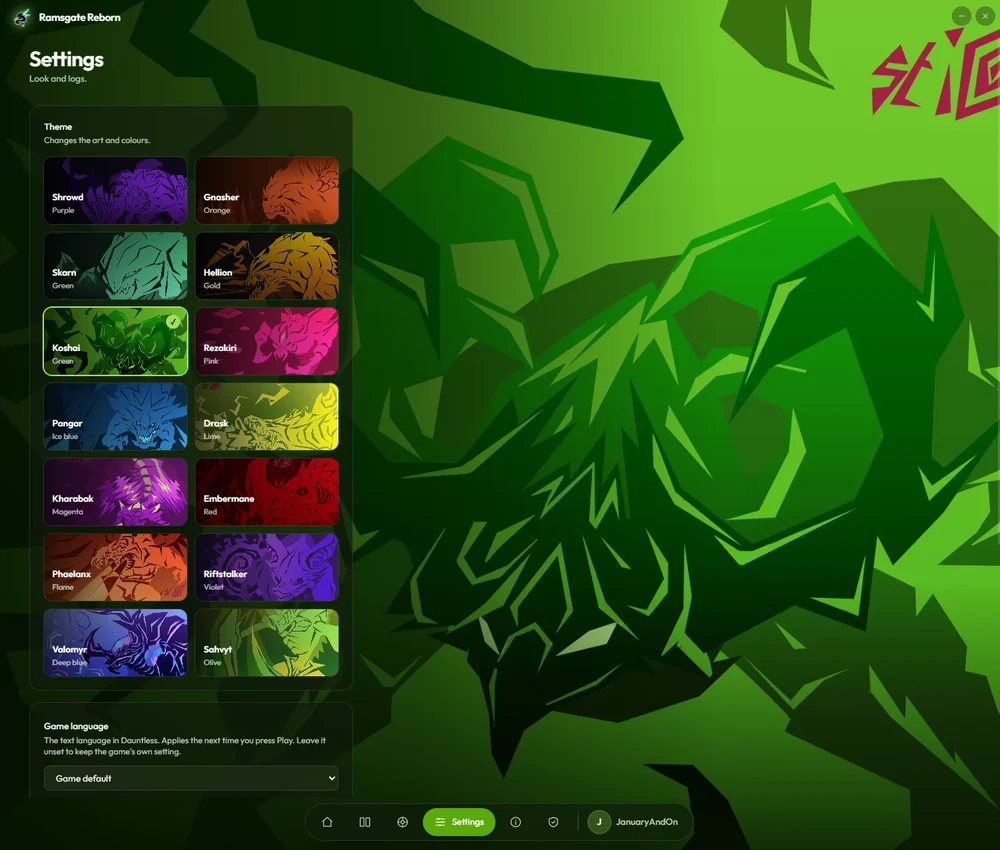

<p align="center">
  
</p>

<p align="center"><b>Dauntless 1.12, kept alive.</b></p>

<p align="center">
  <a href="https://play.afterlifeinteractive.com/launcher/v1/updates/windows/x86_64/download"><b>Download</b></a>
  &nbsp;&middot;&nbsp;
  <a href="https://afterlifeinteractive.com/ramsgate-reborn">Website</a>
  &nbsp;&middot;&nbsp;
  <a href="https://support.afterlifeinteractive.com/">Support</a>
</p>

<p align="center">
  <a href="https://github.com/Afterlife-Interactive/ramsgate-reborn/releases/latest"></a>
  <a href="LICENSE"></a>
</p>

## What it is

Ramsgate Reborn is a community server for Dauntless 1.12.0, the free co-op monster hunting game whose
official servers shut down on 30 May 2025. This is its launcher: you sign in with Discord, it checks your
game install, keeps itself up to date and starts the game. The game server is run by us and is not in this
repository, and no game files are either. We are an unofficial fan project and are not affiliated with
Phoenix Labs, Epic Games or Forte Labs.

<table>
  <tr>
    <td width="50%"><br><sub>Play and server status</sub></td>
    <td width="50%"><br><sub>Build planner</sub></td>
  </tr>
  <tr>
    <td width="50%"><br><sub>Hour badges</sub></td>
    <td width="50%"><br><sub>14 behemoth themes</sub></td>
  </tr>
</table>

## Features

- Online and offline mode
- Build planner
- Hour badges
- 14 behemoth themes
- Game language setting
- Save reset

## Install

You need Windows 10 or 11 (64-bit), Dauntless 1.12.0 and a Discord account. Download the installer from the
[latest release](https://github.com/Afterlife-Interactive/ramsgate-reborn/releases/latest) or the
[website](https://afterlifeinteractive.com/ramsgate-reborn), run it (no admin rights needed), sign in and
follow the prompts for your game folder. The installer is not code-signed yet, so Windows SmartScreen may
warn about it. Always start the game from the launcher.

<details>
<summary>Build it</summary>

<br>

The launcher is Tauri 2, Rust and React. You need Node.js 20+, stable Rust with the MSVC target, Visual
Studio C++ Build Tools and WebView2.

```powershell
.\build.ps1
```

`build.ps1` sets the public play host and public verification key and builds the NSIS installer. A build
from source is not signed with our update key, so it will not match the released file byte for byte and
will not take part in automatic updates.

| Folder | What it is |
|---|---|
| `src/` | Launcher interface (React, TypeScript) |
| `src-tauri/` | Sign-in, install check, updates, game launch (Rust) |
| `docs/` | Scope and legal notes |

</details>

## Contributing and support

Launcher bugs: [open an issue](https://github.com/Afterlife-Interactive/ramsgate-reborn/issues/new/choose).
Account or game help goes to the [support site](https://support.afterlifeinteractive.com/). Security
problems: see [SECURITY.md](SECURITY.md).

## Licence

AGPL-3.0-only, see [LICENSE](LICENSE), [NOTICE.md](NOTICE.md) and [ADDITIONAL_TERMS.md](ADDITIONAL_TERMS.md).
Built on Undaunted by gwog (Gregory Morford) and contributors and Mystic Paradox by Pranav Karande; credits
are in the notice. Scope notes: [docs/SCOPE_AND_LEGAL.md](docs/SCOPE_AND_LEGAL.md).

&copy; 2026 Afterlife Interactive LLC
