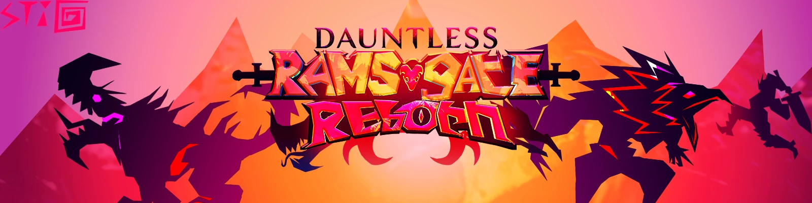
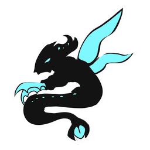
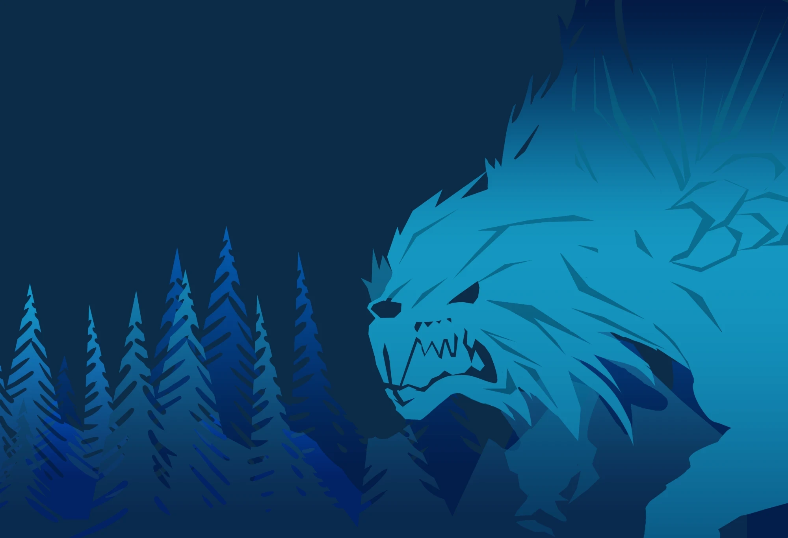
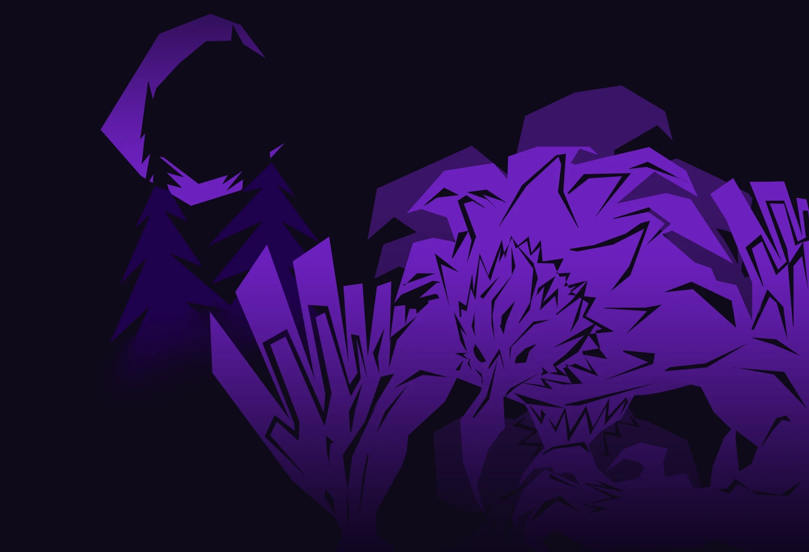
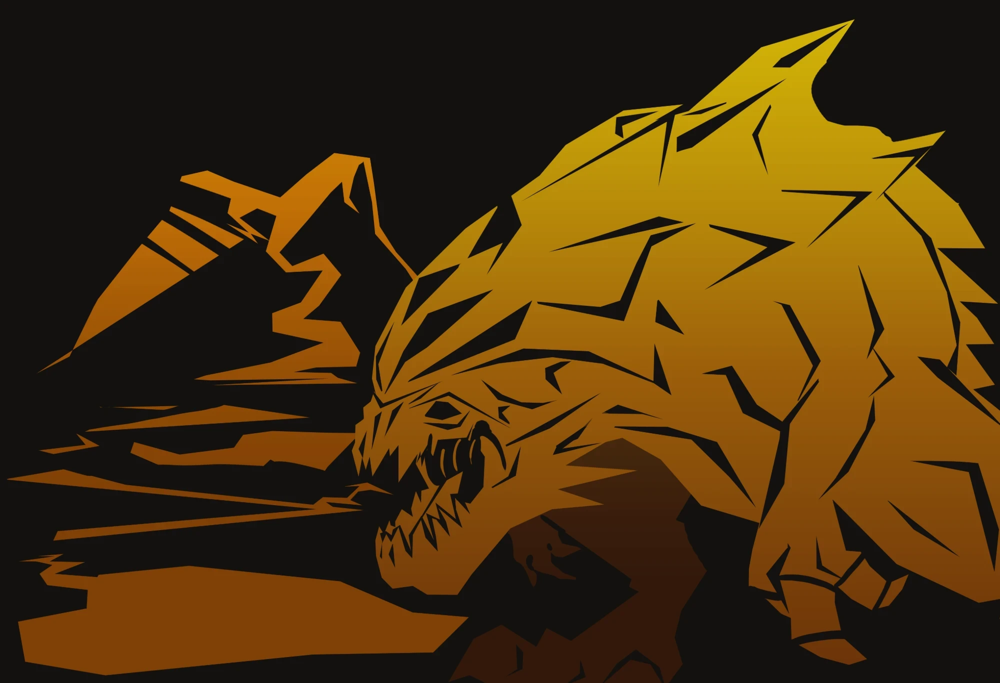
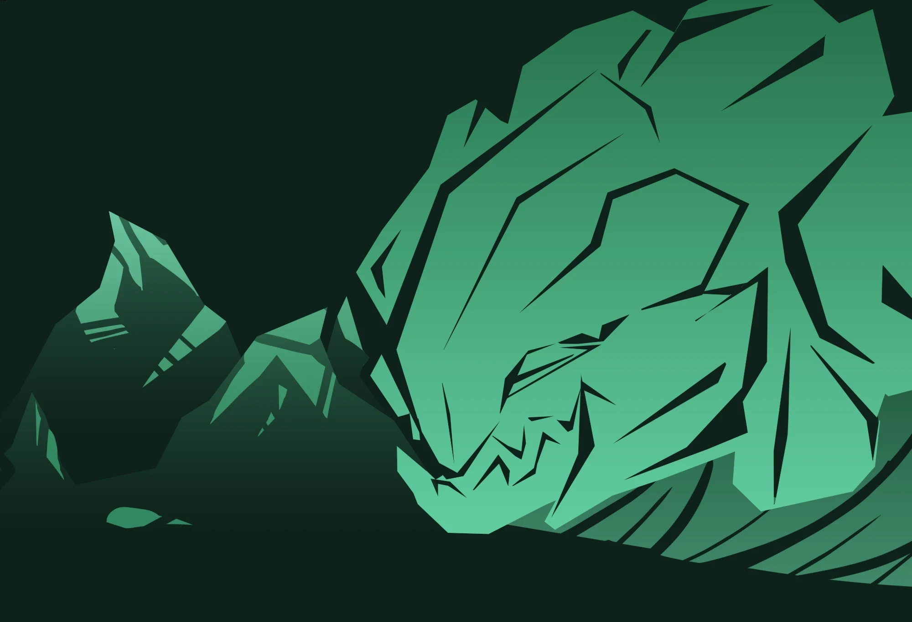

<p align="center">
  
</p>

<p align="center">
  <a href="LICENSE"></a>
  <a href="https://afterlifeinteractive.com/ramsgate-reborn"></a>
  <a href="https://support.afterlifeinteractive.com/"></a>
  <a href="https://discord.gg/dauntlessrevived"></a>
  <a href="https://www.patreon.com/cw/RamsgateReborn"></a>
</p>

<p align="center"></p>

# Ramsgate Reborn Launcher

**Ramsgate Reborn is a community server for Dauntless 1.12.0**, Phoenix Labs' free-to-play co-op
monster-hunting game. The official servers shut down on 30 May 2025. This launcher is how you sign in,
check your game install and play on Ramsgate Reborn. It is built and run by
**Afterlife Interactive LLC**, the group behind Ramsgate Reborn and the Dauntless Revived community.

The server side is built on the work of **Undaunted** by gwog (Gregory Morford) and contributors and
**Mystic Paradox** by Pranav Karande, both AGPL-3.0, whose credits are in [NOTICE.md](NOTICE.md). No game
files are in this repository.

> This repository is the launcher only. The game server is run by us and is not part of it.

## Quick answers

### Can I play Ramsgate Reborn?
Yes, with a Discord account. Install the launcher below and sign
in. Opening news and the current state are on the [website](https://afterlifeinteractive.com/ramsgate-reborn)
and in the [Discord](https://discord.gg/dauntlessrevived). Need help? Use the [support site](https://support.afterlifeinteractive.com/).

### Which version of the game does it work with?
Only **1.12.0** (changelist 392819). The launcher checks your install before it lets you play.

### Do I need an Epic Games account?
No. You sign in with Discord.

### Is it official?
No. It is an unofficial, non-commercial fan project and is not affiliated with Phoenix Labs, Epic Games
or Forte Labs. Dauntless belongs to its owners.

### Where do I get help?
On the [support site](https://support.afterlifeinteractive.com/). The [Discord](https://discord.gg/dauntlessrevived)
is for announcements and the community. For a launcher bug you can also open an issue here.

## Download

Get the installer from the [website](https://afterlifeinteractive.com/ramsgate-reborn). The launcher updates
itself after that.

The installer is not code-signed yet, so Windows SmartScreen may warn about it. Questions go to the
[support site](https://support.afterlifeinteractive.com/).

## Requirements

- Windows 10 or 11, 64-bit
- Dauntless 1.12.0: the launcher checks your game install before it lets you play
- Microsoft Edge WebView2 Runtime (already on current Windows 10/11)
- A Discord account

## Install and play

1. Download and run the installer. It installs for your user only and does not need admin rights.
2. Open Ramsgate Reborn and choose Sign in with Discord.
3. Follow the launcher's prompts for your game folder.
4. If it reports missing or outdated files, press Repair. Then press Play.

The launcher keeps itself up to date. Always start the game from the launcher, not from the game executable.

## Launcher themes

The launcher has four themes, shown here with the art it ships with.

<p align="center">
  
  
  
  
</p>

## Quick links

| Link | What you'll find |
|---|---|
| [Website](https://afterlifeinteractive.com/ramsgate-reborn) | Ramsgate Reborn news and status |
| [Launcher download](https://afterlifeinteractive.com/ramsgate-reborn) | The installer |
| [Support](https://support.afterlifeinteractive.com/) | Help with the launcher, your account or the game |
| [Discord](https://discord.gg/dauntlessrevived) | Announcements, community, finding players |
| [Our mission](https://afterlifeinteractive.com/mission.html) | Why we restore games, credits and how funding works |
| [Scope and legal](docs/SCOPE_AND_LEGAL.md) | What is not included, responsible use, licence |
| [Security](SECURITY.md) | How to report a problem privately |

## Building from source

The source here is the launcher only (Tauri 2, Rust, React). You need Node.js 20+, stable Rust with the MSVC
target, Visual Studio C++ Build Tools and WebView2.

```powershell
.\build.ps1
```

`build.ps1` sets the public play host and public verification key, then builds the NSIS installer. A build
from source is not signed with our update key, so it will not match the released file byte for byte and will
not take part in automatic updates.

| Folder | What it is |
|---|---|
| `src/` | The launcher interface (React, TypeScript) |
| `src-tauri/` | The native side: sign-in, install check, signed updates, game launch (Rust) |
| `docs/` | Scope and legal notes |

## Credits and licence

Ramsgate Reborn is a modified fork built on **Undaunted** (gwog / Gregory Morford and contributors) and
**Mystic Paradox** (Pranav Karande). Licensed under the GNU Affero General Public License v3.0 only, see
[LICENSE](LICENSE), [NOTICE.md](NOTICE.md) and [ADDITIONAL_TERMS.md](ADDITIONAL_TERMS.md).

&copy; 2026 Afterlife Interactive LLC. Independent fan project. Not affiliated with Phoenix Labs or Forte Labs.
