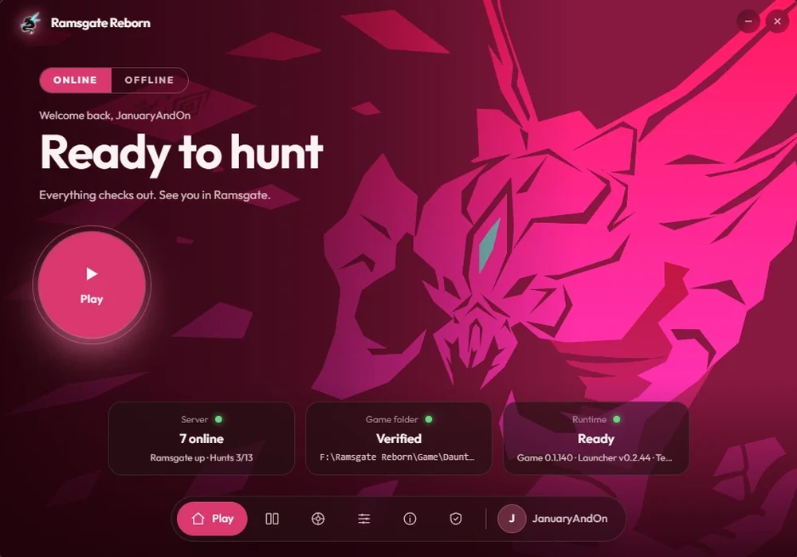
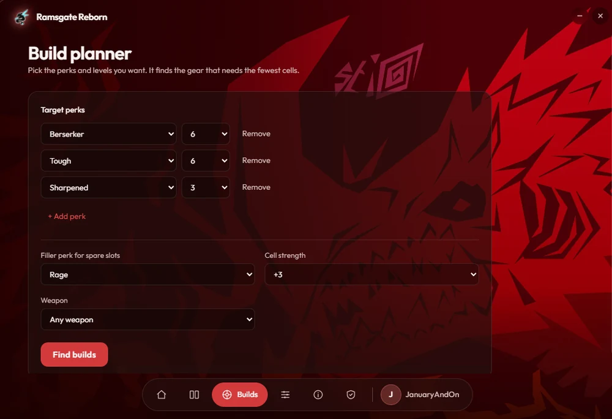
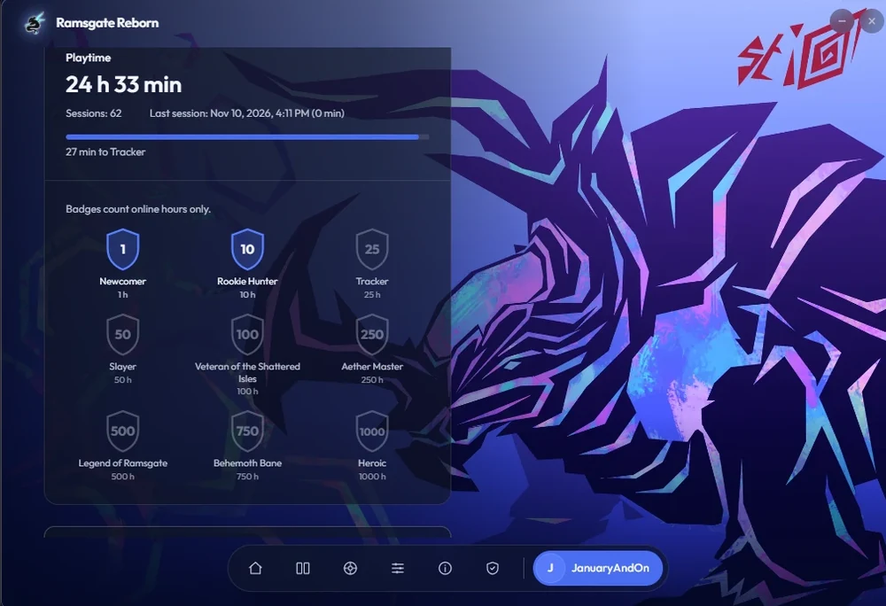

<p align="center">
  
</p>

<p align="center"><b>Dauntless 1.12, kept alive.</b></p>

<p align="center">
  <a href="https://play.afterlifeinteractive.com/launcher/v1/updates/windows/x86_64/download"><b>Download</b></a>
  &nbsp;&middot;&nbsp;
  <a href="https://afterlifeinteractive.com/ramsgate-reborn">Website</a>
  &nbsp;&middot;&nbsp;
  <a href="https://support.afterlifeinteractive.com/">Support</a>
  &nbsp;&middot;&nbsp;
  <a href="https://discord.gg/dauntlessrevived">Discord</a>
</p>

<p align="center">
  <a href="https://github.com/Afterlife-Interactive/ramsgate-reborn/releases/latest"></a>
  <a href="LICENSE"></a>
</p>

## What it is

Ramsgate Reborn is a community server for Dauntless 1.12.0, the free co-op monster hunting game whose
official servers shut down on 30 May 2025. This is its launcher: you sign in with Discord, it checks your
game install, keeps itself up to date and starts the game. The game server is run by us and is not in this
repository, and no game files are either. We are an unofficial fan project and are not affiliated with
Phoenix Labs, Epic Games or Forte Labs.

**Status:** Dauntless 1.12 is open to everyone. Work on Dauntless 1.14.7 is in progress, with no release date
yet. News goes out in the [Discord](https://discord.gg/dauntlessrevived) first.

<table>
  <tr>
    <td width="50%"><br><sub>Play and server status</sub></td>
    <td width="50%"><br><sub>Build planner</sub></td>
  </tr>
  <tr>
    <td width="50%"><br><sub>Hour badges</sub></td>
    <td width="50%"><br><sub>14 behemoth themes</sub></td>
  </tr>
</table>

<p align="center">
  <a href="#quick-start">Quick start</a> &middot;
  <a href="#features">Features</a> &middot;
  <a href="#servers">Servers</a> &middot;
  <a href="#faq">FAQ</a> &middot;
  <a href="#troubleshooting">Troubleshooting</a> &middot;
  <a href="#building-from-source">Building</a> &middot;
  <a href="CHANGELOG.md">Changelog</a>
</p>

## Quick start

1. Download the installer from the [website](https://afterlifeinteractive.com/ramsgate-reborn) or the
   [latest release](https://github.com/Afterlife-Interactive/ramsgate-reborn/releases/latest).
2. Run it. It installs for your user and needs no admin rights. The installer is not code-signed yet, so
   Windows may warn you first (see the [FAQ](#faq)).
3. Open the launcher and press **Sign in with Discord**. There is no separate password.
4. Pick your game folder, or let the launcher download the game for you.
5. Press **Play**. Always start the game from the launcher.

If you played Dauntless Revived, keep it installed when you sign in. See
[Coming from Dauntless Revived](#coming-from-dauntless-revived).

## System requirements

| | |
|---|---|
| Operating system | Windows 10 or 11, 64-bit |
| Game | Dauntless 1.12.0 in the Ramsgate Reborn build. The launcher can download it for you. |
| Disk space | The launcher is about 50 MB. The game is about 16 GB and needs about 34 GB free while it installs. The launcher shows the exact figures before it starts. |
| Network | An internet connection |
| Account | A Discord account |

An existing game folder is only accepted if the server recognises it as the Ramsgate Reborn game. Copies from
Steam, Epic, the old official launcher or Dauntless Revived are refused, and the launcher offers to download
the right game instead.

## What the launcher does

<details>
<summary>Step by step, from sign-in to the game window</summary>

<br>

1. **Sign in.** Sign in with Discord opens Discord in your browser. When you approve, the browser hands you
   back to the launcher. New accounts pick a launcher username. Your session is stored encrypted on your PC,
   so you stay signed in between launches.
2. **Game folder.** The launcher looks for your game, shows the folder and the SHA-256 of the game
   executable (`Dauntless-Win64-Shipping.exe`), and the server decides whether that executable is the
   Ramsgate Reborn game. With no game yet it offers to download one. The download shows speed and time left,
   checks the files, unpacks them, and picks up where it left off if it is interrupted.
3. **Runtime.** The launcher keeps the Ramsgate Reborn client runtime files next to the game up to date.
   Missing or damaged runtime files can be fetched again from the Game files tab.
4. **Play.** When you press Play the launcher re-checks the game files, updates the runtime if needed, asks
   the account server for a session and starts the game, then minimises. When the hunt servers are near full
   you may wait in a queue, with your place shown and a Leave queue button. Play comes back on its own when
   the game closes.
5. **Updates.** The launcher updates itself. If your version is too old for the server, it asks you to
   update.

</details>

## Features

- **Online and offline mode.** A switch on the Play tab. Offline mode runs a separate local copy on your PC
  with its own save and never connects to the online servers. The only thing that can come from your online
  account is a read-only copy of your save that you load yourself. Nothing ever goes back up.
- **Build planner.** The Builds tab plans perk and cell builds from target perks, and works offline.
- **Hour badges.** The Account tab counts your online hours and unlocks badges at 1, 10, 25, 50, 100, 250,
  500, 750 and 1000 hours, from Newcomer up to Heroic.
- **14 behemoth themes.** Shrowd, Gnasher, Skarn, Hellion, Koshai, Rezakiri, Pangar, Drask, Kharabak,
  Embermane, Phaelanx, Riftstalker, Valomyr and Sahvyt. You pick one on first launch and can change it in
  Settings.
- **Game language.** Pick the in-game language in Settings, or leave it on the game default.
- **Server status.** The Play tab shows whether the servers are reachable and how many players are online.
- **Regions.** The launcher measures your connection to each region by itself and reports it, so hunts can be
  placed near you.
- **Dauntless Revived transfer.** Move your Revived account over, see below.
- **Save reset.** Start over with a new save from the Account tab, see below.
- **Logs and crash dumps.** The launcher keeps a log of every session. Crash dumps are only sent if you
  allow it.
- **Uninstall.** The Game files tab can remove the game the launcher installed.

<details>
<summary>Save reset in detail</summary>

<br>

Account tab, Reset my save data. It gives your account a new save, as if you had just made it. You have to
close the game, read the warning and type `RESET` to confirm, and it can be done once every 24 hours. All
progress, levels, items, currency and unlocks are deleted. Your account and login, Discord link, friends list
and Dauntless Revived link stay. A backup of the old save is kept for 30 days. Only staff can restore it, and
only if you ask.

</details>

### Coming from Dauntless Revived

Install the launcher, keep Dauntless Revived installed, and sign in. The launcher reads your Dauntless Revived
account key and transfers your inventory, loadout, wallet, appearance, weapon levels and Escalation progress.
It only works before you start playing for real on Ramsgate Reborn (finishing a hunt, earning XP or currency,
or getting items), so please do not play until the launcher says the transfer is ready. Waiting is safe. If
you play first, your transfer can be cancelled. While a transfer is pending the launcher keeps Play off. If
something did not arrive, the Game files tab has a button to ask for it again.

## Servers

The main server is in London, UK. Hunt servers run from London, New York, Canada, Singapore and Oceania.
Latency rises the further you are from the nearest hunt server. Server status is public, and the launcher
shows it on the Play tab. More on the [website](https://afterlifeinteractive.com/ramsgate-reborn).

## FAQ

Short answers here, more in [docs/FAQ.md](docs/FAQ.md).

<details>
<summary>Is it safe? Windows warns about the installer.</summary>

<br>

The installer is not code-signed yet, so Windows SmartScreen may show a warning. Click More info, then Run
anyway. To check you have the real file, compare its SHA-256 with the hash in the release notes. In
PowerShell, with the name of the file you downloaded:

```powershell
Get-FileHash .\RamsgateReborn-main-<version>-setup.exe -Algorithm SHA256
```

The launcher source is in this repository.

</details>

<details>
<summary>Is it official?</summary>

<br>

No. It is an independent fan project, not affiliated with Phoenix Labs, Epic Games or Forte Labs. Dauntless
belongs to its owners.

</details>

<details>
<summary>Does it work on Linux or macOS?</summary>

<br>

We only publish a Windows 10/11 64-bit launcher.

</details>

<details>
<summary>Do I keep my Dauntless Revived progress?</summary>

<br>

Yes, if you transfer before you start playing for real. See
[Coming from Dauntless Revived](#coming-from-dauntless-revived).

</details>

<details>
<summary>How do I report a bug?</summary>

<br>

Launcher bugs go to [GitHub issues](https://github.com/Afterlife-Interactive/ramsgate-reborn/issues/new/choose).
The form asks for your launcher version, game version and region. Account and game help go to the
[support site](https://support.afterlifeinteractive.com/). Never post passwords, tokens or login codes.

</details>

## Troubleshooting

The common problems are below. The full list is in [docs/TROUBLESHOOTING.md](docs/TROUBLESHOOTING.md).

| Problem | What to try |
|---|---|
| Launcher cannot connect | Some providers fail to resolve the server address. Set your DNS to 1.1.1.1 and 8.8.8.8 and try again. |
| Game login times out | Another launcher may have left settings in the game config that point at a local proxy. The launcher removes them when you press Play. |
| Game does not start | Make sure it is not already open and that your antivirus has not removed game files, then press Play again. |
| "This game folder is not the Ramsgate Reborn game" | Use the download button the launcher offers, or pick the folder that contains `Archon`. |
| Files damaged | Game files tab: Download runtime DLLs, Locate again, or Uninstall and download again. |
| Need your logs | Settings tab, Logs, Open folder. They are in `%LOCALAPPDATA%\RamsgateReborn\Logs\Sessions`. |

## Building from source

<details>
<summary>Requirements and steps</summary>

<br>

The launcher is Tauri 2, Rust and React. You need Node.js 20+, stable Rust with the MSVC target, Visual
Studio C++ Build Tools and WebView2.

```powershell
.\build.ps1
```

`build.ps1` sets the public play host and public verification key and builds the NSIS installer. A build
from source is not signed with our update key, so it will not match the released file byte for byte and
will not take part in automatic updates.

Tests:

```powershell
npm run test:ui    # interface logic, needs Node 22.6+
npm run test       # Rust tests
```

</details>

## Project layout

| Path | What it is |
|---|---|
| `src/` | Launcher interface (React, TypeScript): screens, themes, build planner, offline panel, helpers |
| `src-tauri/` | Sign-in, install check, updates, game launch, offline mode (Rust) |
| `public/` | Static assets |
| `build.ps1` | Release-style build script |
| `docs/` | FAQ, troubleshooting, scope and legal notes |
| `CHANGELOG.md` | Launcher version history |
| `.github/` | Issue template and README artwork |

This repository is the launcher only. The game server and the game files are not here.

## Contributing

Small, focused pull requests are easiest to review. Say what the change does and what you tested, keep
unrelated changes separate, and do not include game files, leaked source or secrets. For anything bigger,
open an issue first. Acceptance is not guaranteed. Contributions are licensed under the same terms as the
project. Security problems go privately to the [support site](https://support.afterlifeinteractive.com/), see
[SECURITY.md](SECURITY.md).

## Code of conduct

Be decent. Stay respectful and on topic, and do not harass, doxx or spam anyone in issues or pull requests.
Do not post other people's private details or your own credentials. Maintainers may remove content and block
people who ignore this.

## Credits

Ramsgate Reborn is built and run by ZFXSTATIC at Afterlife Interactive LLC. It started from earlier community
projects: Undaunted by gwog (Gregory Morford) and contributors, and Mystic Paradox by Pranav Karande, whose
Dauntless 1.12.0 port and related modifications are part of this code. Both are AGPL-3.0. Full provenance is in
[NOTICE.md](NOTICE.md).

## Licence

AGPL-3.0-only, see [LICENSE](LICENSE), [NOTICE.md](NOTICE.md) and
[ADDITIONAL_TERMS.md](ADDITIONAL_TERMS.md). Scope notes: [docs/SCOPE_AND_LEGAL.md](docs/SCOPE_AND_LEGAL.md).

## Disclaimer

Ramsgate Reborn is an unofficial fan project. It is not affiliated with, endorsed by or sponsored by Phoenix
Labs, Epic Games or Forte Labs. Dauntless and its related names belong to their owners. No game files are
distributed in this repository. It is provided without warranty, use it at your own risk.

&copy; 2026 Afterlife Interactive LLC
